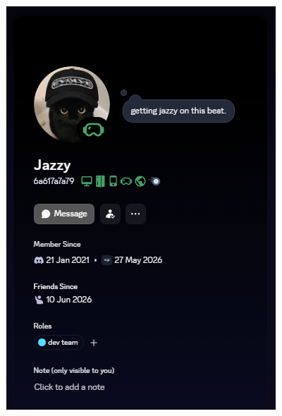

# Discord Platform Spoofer

Spoof multiple Discord platform sessions simultaneously using raw WebSocket in Node.js (CommonJS).

## Features

* Spoof as:
  * Discord VR (Meta Quest 3)
  * Discord Embedded (PS5)
  * Discord Android
  * Discord Client (Desktop)
  * Discord (Web)

* Raw WebSocket gateway — zero dependency on `discord.js` or `discord.js-selfbot-v13`
* Accurate user Gateway v9 handshake (proper client properties, capabilities, client state, and no invalid bot intents)
* Multi-token support: runs across multiple accounts simultaneously
* Automatic session resumption (`RESUME`) on disconnect
* Heartbeat management with zombie connection detection
* Connection staggering to prevent gateway rate-limits

## Installation

```bash
npm install
```

## Configuration

Edit `src/storage/config.json`:

```json
{
  "tokens": [
    "your-token-1",
    "your-token-2"
  ],
  "forceOnlineMode": true,
  "devices": {
    "Discord VR": { "name": "Meta Quest 3", "spoof": true },
    "Discord Embedded": { "name": "PS5", "spoof": true },
    "Discord Android": { "name": "sdk_gphone64_x86_64, sdk_gphone64_x86_64", "spoof": true },
    "Discord Client": { "name": "Desktop", "spoof": true },
    "Discord": { "name": "Web", "spoof": true }
  }
}
```

Replace `tokens` with your Discord account token(s). A single `"token": "..."` string is also accepted for backward compatibility.

## Usage

```bash
npm start
```

## Example Output

```text
spoofed as Discord Embedded on PS5 | username
spoofed as Discord Android on sdk_gphone64_x86_64, sdk_gphone64_x86_64 | username
spoofed as Discord on Web | username
spoofed as Discord VR on Meta Quest 3 | username
spoofed as Discord Client on Desktop | username
```

## Project Structure

```
discord-device-spoofing-nodejs/
├── src/
│   ├── Classes/
│   │   └── Gateway.js      # Raw WebSocket connection, IDENTIFY, RESUME, and heartbeat
│   ├── types/
│   │   └── index.d.ts      # TypeScript interfaces and type definitions
│   ├── utils/
│   │   └── config.js       # Configuration loader and validator
│   ├── storage/
│   │   └── config.json     # Account tokens and device configuration
│   └── index.js            # Application entry point
│
├── jsconfig.json
├── package.json
└── README.md
```

## Disclaimer

This project connects to Discord's Gateway API. Automating user accounts may violate Discord's Terms of Service. Use at your own risk.
